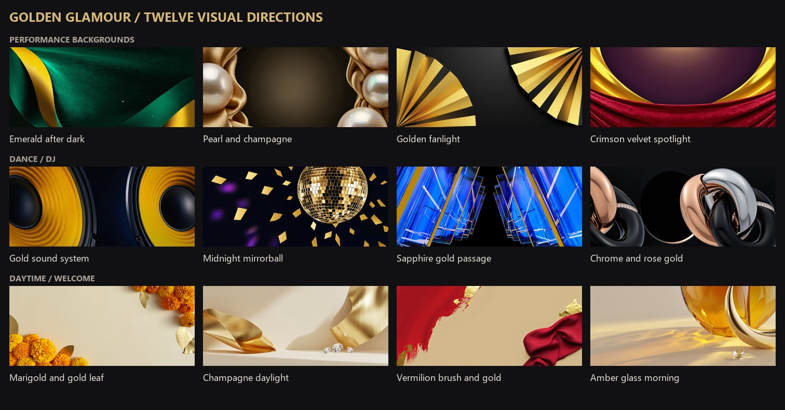
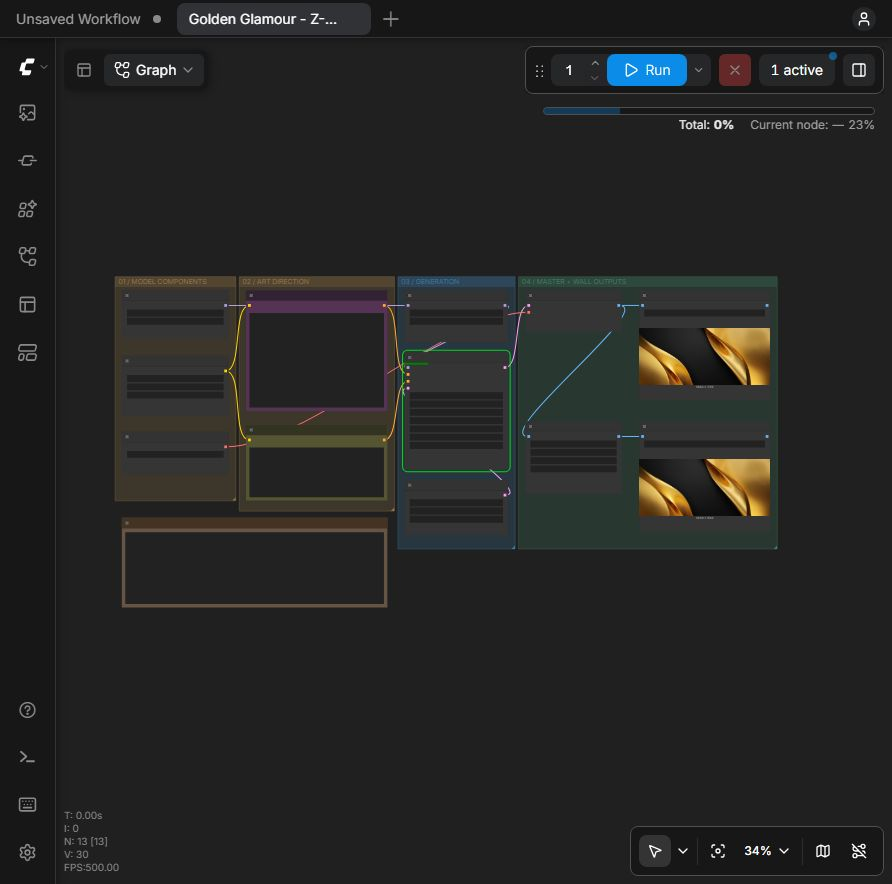

# Durga visuals 2026

Golden glamour and contemporary bling for a three-night Durga event. Generate on a Windows RTX 5090; play from an M1 Max Mac in Resolume. LED wall: **1248 x 540**, aspect **104:45**.



## Start here

- [Ma Durga image review](Ma/index.html): local Qwen and Z-Image studies, close-review notes, [editable prompts](Ma/prompts.json), and [generation/editing workflows](Ma/README.md). These are separate from the abstract background collection.
- [Colorful animated DJ titles](shaders/README.md#colorful-dj-titles), [USB reuse notes](MATERIAL-NOTES.md), and [actual 3D options for later](Ma/3D-NEXT.md).
- [Mac handoff and familiar layer setup](MAC-HANDOFF.md), plus [transparent DJ title layers](outputs/dj-titles/).
- **Meeting demo:** [15 curated looks](outputs/demo.html), a [90-second silent overview](outputs/meeting-showreel.mp4), and the [meeting guide](MEETING.md). The local `outputs/meeting-demo.zip` bundles everything for the Mac; extract it and open `demo.html`.
- **Current direction: live GLSL through Resolume Wire.** Start with the [first-patch walkthrough](shaders/README.md). Use the stills as textures; the completed video collection is optional.
- [Show plan and camera experiment](SHOW-PLAN.md): Mac rehearsal, output mapping, operating layout, and the first X4/OBS test.
- [Browse the collection](outputs/index.html): 39 still renders and 11 finished loops. The meeting selection contains 12 new still directions and three existing motion samples. Open either page locally to review it.
- [Wall stills](outputs/stills/wall/) and [1664 x 720 masters](outputs/stills/master/).
- [Looping MP4 clips](outputs/video/loops/) and [motion prompts](outputs/golden-glamour-motion-prompts.json).
- [Original still prompts](outputs/golden-glamour-prompts.md), [meeting prompts](outputs/meeting-prompts.md), [render settings and seeds](outputs/catalog/), and [video processing records](outputs/video/catalog/).
- [Live GLSL shaders and Resolume routing](shaders/README.md), with an interactive local preview.
- [Setup and verification](outputs/setup-status.md). ProRes LT masters stay local in `outputs/video/prores/`; model weights and raw video are excluded from Git.

## ComfyUI setup

1. Install a current ComfyUI with NVIDIA-compatible PyTorch. Tested here with ComfyUI 0.39.0, Torch 2.14.1+cu130, and an RTX 5090 with 32 GB VRAM.
2. Copy [extra_model_paths.yaml](outputs/extra_model_paths.yaml) into the ComfyUI root, merging existing configuration if needed. It points to `D:/AI/models/`; change that path for another machine. Restart while the queue is empty.
3. Put the weights below in the indicated subfolders. No custom nodes are required.
4. Drag a workflow JSON into ComfyUI. For motion, select a generated wall PNG in the reference-image node, then Run. If a newly copied image is missing, use **Edit > Refresh Node Definitions** and select it again. **Fit View (.)** frames the graph.

| Workflow | Model files under `D:/AI/models/` |
| --- | --- |
| [Full Z-Image](outputs/golden-glamour-z-image.json) | `diffusion/z_image_bf16.safetensors`, `text_encoders/qwen_3_4b.safetensors`, `vae/ae.safetensors` |
| [Wan 2.2 motion](outputs/golden-glamour-wan-motion.json) | `diffusion/wan2.2_i2v_high_noise_14B_fp8_scaled.safetensors`, `diffusion/wan2.2_i2v_low_noise_14B_fp8_scaled.safetensors`, `text_encoders/umt5_xxl_fp8_e4m3fn_scaled.safetensors`, `vae/wan_2.1_vae.safetensors` |

Download instructions and model cards: [Z-Image](https://docs.comfy.org/tutorials/image/z-image/z-image), [Wan 2.2](https://docs.comfy.org/tutorials/video/wan/wan2_2), [official Wan repack](https://huggingface.co/Comfy-Org/Wan_2.2_ComfyUI_Repackaged). Weights are separate downloads with their own upstream terms. The motion graph adapts ComfyUI's official first/last-frame template.

## Wiring refresher



Connect sockets with matching types. One output can feed multiple inputs.

- **Model:** diffusion loader -> sampling shift -> sampler.
- **Prompt:** text encoder -> positive/negative text encode -> sampler conditioning. The legacy `CLIP` label includes Qwen and UMT5 here.
- **Image:** empty latent -> sampler -> VAE decode -> Save Image. The VAE turns compressed latents into pixels; it does not interpret the prompt.
- **Motion:** one reference image feeds both first and last frame inputs -> high-noise sampler -> low-noise sampler -> VAE decode -> Create Video -> Save Video.

Full Z-Image uses **35 steps / CFG 4 / res_multistep / simple / shift 3**. Wan uses **20 total steps / CFG 4 / Euler / simple / shift 8**, split 10+10 across its two experts. Keep a seed fixed to compare prompt changes.

Wan produces 81 frames at 16 fps on a 1248 x 544 canvas. The delivery script crops two pixels from the top and bottom, interpolates motion, then eases forward and backward through an 8-second cycle at 30 fps. This avoids a tail-to-head dissolve. Endpoint conditioning alone does not guarantee a clean seam. Clips prefixed `FX_` instead use periodic 2D displacement of a still; they are procedural animations, not Wan video. Review motion and joins before show playback.

Useful later additions: compatible LoRA for style, image-to-image through VAE Encode, masks/inpainting for local changes, model-compatible ControlNet for structure, and upscaling after decoding. Adapters from SDXL, FLUX, Z-Image, and Wan are not interchangeable.

## Reproduce batches

Run from the project root with the portable Python executable or an environment containing Pillow, NumPy, and SciPy. ComfyUI must be running at `http://127.0.0.1:8188`; FFmpeg and FFprobe must be on PATH for loop delivery. Replace `<ComfyUI>` with your actual ComfyUI directory.

```powershell
python scripts/render_stills.py --comfy-root '<ComfyUI>' --variants 1
python scripts/render_stills.py --comfy-root '<ComfyUI>' --prompts outputs/meeting-prompts.md --seed 2026101400 --variants 2
python scripts/render_motion_batch.py --comfy-root '<ComfyUI>' --start 0 --count 1
python scripts/contact_sheet.py
```

The scripts save seeds and prompts, retain PNG workflow metadata, and stop if another render occupies the queue. Completed catalog entries allow resuming a batch. API versions of both workflows are included beside the UI JSONs. MCP is optional; these scripts use the local ComfyUI API directly.

## Resolume handoff

Use a **1248 x 540** composition. Start with liquid gold or vermilion silk behind performers; use the waveform, facets, chains, and prisms for DJ material. Stills also animate through transforms, distortion, feedback, kaleidoscopes, and audio-reactive effect parameters. Video is useful source motion, not a requirement for every effect.

The clips in `video/loops/` have no audio and use all-intra H.264. Local ProRes LT copies are available for conversion to DXV in [Resolume Alley](https://resolume.com/software/alley). Repeating a delivered loop uses normal forward looping; avoid an extra clip crossfade that would change its timing. Try slow playback and gentle effects first. Reversal, where used, is already baked in. These short cycles are reusable building blocks, not a finished three-night show. The separate meeting showreel is a labeled 1280 x 720 presentation, not a wall-ready loop.

Black overlay plates are RGB, not transparent: use Screen/Add and adjust opacity. Confirm readability and brightness on the actual wall. Existing Durga/Sindoor Khela imagery remains on last year's USB and is not included here. Live camera interaction is a separate later experiment.
