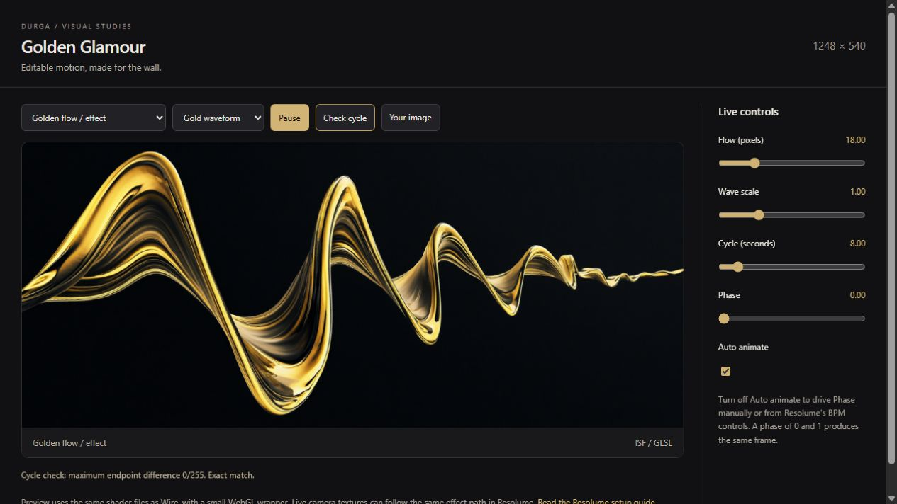

# GLSL into Resolume

**Start with [the Mac Wire + GLSL tutorial](WIRE-TUTORIAL.md)** for the current DJ/Dandiya direction: beat control, title takeovers and editable code examples. The two new files under `examples/` have static checks only and are not in the browser preview. The catalog below describes the browser-validated shaders.

These are editable **ISF 2.0 fragment shaders**: GLSL plus a JSON input declaration. They use no external textures except the source image for the three effects.

| File | Role | Good starting point |
| --- | --- | --- |
| [LiquidGold.fs](LiquidGold.fs) | Procedural source | Quiet gold motion behind performers; no image required |
| [GoldenFlow.fs](GoldenFlow.fs) | Texture effect | Make the generated stills flow; try 12-24 pixels of displacement |
| [DiamondKaleidoscope.fs](DiamondKaleidoscope.fs) | Texture effect | DJ visuals or a live camera; start with six facets and slow rotation |
| [GoldDust.fs](GoldDust.fs) | Procedural source | Sparse drifting glitter; use Screen/Add as a quiet accent |
| [GoldRibbons.fs](GoldRibbons.fs) | Procedural source | Twisting metallic ribbons framing performers |
| [PrismField.fs](PrismField.fs) | Procedural source | Moving faceted reflections for DJ material |
| [PrismaticTitle.fs](PrismaticTitle.fs) | Transparent title effect | Colorful chrome and apparent extrusion for all three DJ names |
| [GoldTitleTakeover.fs](GoldTitleTakeover.fs) | Transparent title effect | Gold DJ-name takeover: metallic sweep, glints, bloom, Intro punch/glitch and beat Pulse. See [the tutorial](WIRE-TUTORIAL.md#4-dj-name-takeover-goldtitletakeover) |

All eight are in the local preview (`python3 -m http.server 8765` from the repo root, then open `/shaders/preview/`). The preview can show titles over a busy still and has a 124 BPM demo for Intro and Pulse. [Additional source settings and validation](NEW-SHADERS.md) cover the three new procedural looks. The procedural sources output opaque RGB; black becomes a transparent-looking accent only through the chosen blend mode.



## Colorful DJ titles

Open [the title preview](http://127.0.0.1:8970/shaders/preview/?shader=PrismaticTitle), then choose DJ Edwin, DJ Mumbai Rani, or DJ Dinu from Source image. This is a 2.5D shader, not a generated mesh: it takes the existing title PNG's alpha, recolors its front face and adds moving apparent depth. Spelling stays exact. Original gold PNGs remain available.

In Wire, use category **Effect** and `Texture In -> ISF (PrismaticTitle.fs) -> Texture Out`. Apply to a title PNG clip from `outputs/dj-titles/`, above the background, using normal alpha compositing. Output is straight alpha. Expose Depth, Color offset, Chrome shine and Cycle. Try color offsets 0.00, 0.33 and 0.66 to distinguish the DJs. Keep depth around 12-24 pixels and avoid cropping the title before the effect.

The title shader compiled in the browser and all three names passed the default phase 0/1 comparison at 0/255 difference. The longest name fits with extrusion. Native Wire compilation, blending and Mac performance still need testing. Use Wire's video export for a backup after choosing colors.

## Your first patch in Wire

You own Wire, so use its native integration. Start with **LiquidGold**, which requires only two rendering nodes and no media input.

1. Create a new patch. Set its category to **Source** in the Patch panel, and its working resolution to **1248 x 540**.
2. Add an **ISF** node. Select it, then choose **Attributes > Fragment Shader > Browse** and load `LiquidGold.fs`.
3. Connect the ISF texture output to a **Texture Out** node. The output should now show animated gold folds.
4. Add **Float In** nodes and connect them to `folds`, `clearCenter`, `exposure`, and `loopSeconds`. Rename them Fold scale, Open center, Brightness, and Cycle. Copy the defaults and ranges from the shader's JSON header. This makes them sliders in Resolume. Leave `animate` true and `phase` at zero initially.
5. Save as **Durga Liquid Gold**. In Avenue/Arena, find the saved source and drag it into a clip slot. Use a 1248 x 540 composition. Adjust the sliders while it plays.
6. For editing, use **View > Layout > Shader Editing** in Wire. Change the shader there, check the output, and save. Keep your edited `.fs` source in this repository too.

The `.fs` file contains the shader; Wire supplies the patch, texture output, and Resolume controls. These steps follow the official [ISF loading guide](https://resolume.com/support/en/isf) and [Wire integration guide](https://resolume.com/support/en/wire-resolume-integration).

For **GoldenFlow**, **DiamondKaleidoscope** or **PrismaticTitle**, create a patch in category **Effect** with this graph:

```text
Texture In ----------> ISF ----------> Texture Out
                       ^
Float In / Bool In ----+  (one connection per exposed parameter)
```

Load the corresponding `.fs` into the ISF node. Connect Texture In to `inputImage`; let texture nodes follow Patch resolution. Save, then apply the effect to a still-image clip in Resolume. GoldenFlow is a good first effect: expose `amount`, `detail`, and `loopSeconds`. Leave unconnected shader inputs at their defaults.

## Starting looks

These are suggested settings to dial in, not compiled Wire presets. Keep Auto animate on and Phase at zero.

| Use | Shader / texture | Settings |
| --- | --- | --- |
| Quiet performance background | LiquidGold | folds 0.9, clearCenter 0.55, polish 0.6, exposure 0.8, loopSeconds 24 |
| Flowing silk | GoldenFlow / P05 vermilion still | amount 14, detail 0.8, loopSeconds 16 |
| Gold waveform | GoldenFlow / D03 waveform still | amount 28, detail 1.2, loopSeconds 8 |
| Diamond DJ pattern | DiamondKaleidoscope / D02 prism still | segments 6, zoom 1.15, breath 0.06, loopSeconds 16 |

The generated stills retain their photographic detail under the effects. LiquidGold instead synthesizes every pixel. Texture displacement does not reconstruct 3D geometry, so use modest flow for recognizable chains and diamonds.

## Saving for the show

For portable handoff, consolidate the resources and compile an editable `.wired` patch using a suitably licensed Wire installation. A compiled patch can run in compatible Avenue/Arena without the recipient owning Wire. Check the patch's minimum host version. This repository contains shader sources, not precompiled Wire patches. [Saving and compiling](https://resolume.com/support/en/wire-saving-consolidating) · [Compatibility](https://resolume.com/support/en/patch-compatibility)

Test on the M1 Max with the intended composition and layer count. Wire can also export a patch through **Patch > Export as Video** when it has a Texture Out node. Keep rendered backups of favorite looks for the show. [Video export](https://resolume.com/support/en/wire-saving-consolidating)

## Timing, audio, and camera

- Auto animate uses `TIME / loopSeconds`. Temporal frequencies are integer multiples of one cycle; phase 0 and 1 match exactly for a static input. An independently moving camera/video will not itself become a seamless loop.
- For beat control, switch Auto animate off and drive Phase from 0 to 1 in the host. Keep the cycle duration fixed during a take to avoid jumping the clock's phase.
- For audio response, modulate Flow or Brightness gently. Wire's Spectrum input and Falloff can provide a smoothed envelope. Avoid mapping noisy FFT directly to Phase. [Wire FFT inputs](https://resolume.com/support/en/wire-resolume-integration)
- The texture effects can process a camera feed, but capture hardware, latency, silhouettes, and trails are not configured by these shaders. Neither effect uses a persistent feedback buffer.

For your own code, build animation from `sin(2*pi*phase)` and `cos(2*pi*phase)`, with integer temporal harmonics. For evolving noise, sample a circular path such as `noise(vec3(uv, 0) + vec3(cos(t), sin(t), 0))`. Simply wrapping arbitrary linear motion with `fract` does not make it visually continuous. All current shaders use periodic functions across the wrap. Fixed-input loop closure also requires fixed parameter values.

## Optional Mac routing without a Wire patch

The free [Desktop ISF Editor](https://isf.vidvox.net/desktop-editor/) can open these shaders and publish through Syphon. Select its stream under Resolume Sources and drag it into a clip. Both apps run on the same Mac. This is an optional experimentation route; Wire is the primary setup for this project. [Syphon instructions](https://www.resolume.com/support/syphonspout)

## Preview and validation

From the repository root, run `python -m http.server 8970 --bind 127.0.0.1`, then open [the preview](http://127.0.0.1:8970/shaders/preview/). It uses the same `.fs` sources with a WebGL 2 wrapper and runs locally. If using ComfyUI portable Python, add `-s` before `-m`.

All seven shaders compiled and rendered in the browser preview; each matched the phase 0/1 comparison with a maximum endpoint difference of **0/255** at default controls. **Check cycle** also compares the frame just before the wrap with phase zero and reports several ordinary frame changes for context. Endpoint equality alone cannot prove a smooth loop; inspect the motion too. This checks WebGL rendering, not native Wire compilation or show-Mac performance. Wire playback remains to be checked on the Mac. Refresh the page after editing a shader file.
